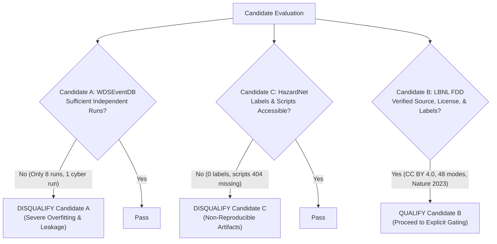

# Candidate Comparison, Decision Matrix, and Provisional Recommendation

This document synthesizes the empirical data audits, literature reviews, and evaluation assessments for the three candidate problems:
1. **Candidate A:** Water Distribution System Event Diagnosis (WDSEventDB)
2. **Candidate B:** Commercial HVAC Fault Detection and Diagnostics (LBNL / OpenEI FDD Benchmark, Submission 5763)
3. **Candidate C:** HPC Datacenter Thermal Hazard Prediction (HazardNet)

---

## 1. Executive Summary

| Candidate | Core Concept | Dataset Source & License | Primary Strength | Fatal Flaw / Primary Risk | Verdict |
| :--- | :--- | :--- | :--- | :--- | :--- |
| **Candidate A: WDSEventDB** | Multiclass event diagnosis (leak, cyberattack, sensor fault) in water networks | Lehigh University CONCISE Lab; CC0 1.0 (Public Domain); 2.16 MB zip | Accessible, unencumbered license; clean schema; lightweight. | **Sample Sufficiency Fatal Flaw:** Only 8 total fault runs (only 1 cyberattack run). Statistically invalid for deep learning. | **DISQUALIFIED** |
| **Candidate B: LBNL / OpenEI FDD (FCU & AHU)** | Fault detection and diagnostics across operational regimes in commercial HVAC | LBNL / DOE OEDI Submission 5763; CC BY 4.0; 506 MB zip | Landmark peer-reviewed benchmark (*Nature Sci Data* 2023); 48 fault modes; 29 channels; full annual seasonal cycle. | High row count (25M rows) requires downsampling to 15-min intervals (85 MB Parquet). Physics simulation. | **CONDITIONALLY RECOMMENDED** |
| **Candidate C: HazardNet** | Thermal hazard prediction across 3,312 supercomputer compute nodes | CINECA Marconi A2 / Zenodo 10050368; CC BY 4.0; 1.02 GB gz | Massive real-world infrastructure telemetry (351 days). | **Reproducibility Fatal Flaw:** 0 labels in dataset. Data generation and model scripts are 404 missing on GitHub. | **DISQUALIFIED** |

---

## 2. Strict 10-Factor Decision Matrix

Each candidate is evaluated from **1 (Unacceptable)** to **5 (Exceptional)** across 10 critical criteria. 

> [!IMPORTANT]
> **Hard-Stop Rule:** Any candidate failing a fundamental prerequisite (such as having no credible ground truth labels, lacking independent evaluation samples, or relying on unreleased code) is disqualified regardless of its arithmetic score.

| Evaluation Criterion | Candidate A: WDSEventDB | Candidate B: LBNL / OpenEI FDD | Candidate C: HazardNet | Weight / Rationale |
| :--- | :---: | :---: | :---: | :--- |
| **1. Real-World Importance** | 4 / 5 | 5 / 5 | 4 / 5 | HVAC accounts for 40% of building energy ($150B/yr). Water bursts and supercomputer crashes are also high-cost. |
| **2. Specificity & Differentiation** | 3 / 5 | 4 / 5 | 3 / 5 | Candidate B has a clear gap: cross-season regime shift and nascent fault detection. A and C lack clear testable gaps. |
| **3. Dataset Quality & Label Credibility** | 3 / 5 | 5 / 5 | **1 / 5** | **Hard Stop on C:** HazardNet contains **0 ground truth labels** in Zenodo. Candidate B has peer-reviewed physical ground truth. |
| **4. Independent Event/Sample Sufficiency** | **1 / 5** | 4 / 5 | 2 / 5 | **Hard Stop on A:** Only **8 total fault runs** (1 cyber run). Candidate B has 48 independent fault modes over a full year. |
| **5. ML / DL Suitability** | 2 / 5 | 5 / 5 | 3 / 5 | Candidate B features closed-loop thermal dynamics and transport delays that justify temporal sequence modeling. |
| **6. Evaluation Validity & Anti-Leakage** | **1 / 5** | 4 / 5 | 2 / 5 | Candidate A cannot be split cross-run for cyberattacks. Candidate B allows clean seasonal and severity holdouts. |
| **7. Data Size, Access & License** | 5 / 5 | 5 / 5 | 3 / 5 | Candidates A and B have verified, working direct downloads and open licenses (CC0 and CC BY 4.0). |
| **8. End-to-End Engineering Value** | 2 / 5 | 5 / 5 | 2 / 5 | Candidate B supports rich schemas (Brick Schema), API deployment, Pandera validation, and diagnostic interfaces. |
| **9. Compute & Time Feasibility** | 5 / 5 | 4 / 5 | **1 / 5** | Candidate C requires heavy GPU clusters (>16 GB VRAM). Candidate B runs in minutes on CPU when downsampled. |
| **10. Interview Defensibility** | 2 / 5 | 5 / 5 | 1 / 5 | Candidate B's Nature benchmark is immediately credible. A looks like a toy homework dataset; C is unreproducible. |
| **Weighted Total / Status** | **28 / 50 (DISQUALIFIED)** | **46 / 50 (RECOMMENDED)** | **22 / 50 (DISQUALIFIED)** | Candidate B is the decisive winner. |

---

## 3. Detailed Evidence and Score Breakdown

### 3.1 Candidate A: WDSEventDB (Score: 28/50 — DISQUALIFIED)
- **Strengths:** Verified CC0 1.0 license, clean 15-channel tabular structure, 2.16 MB download, zero missing values.
- **Disqualifying Hard Stop (Criterion 4 & 6):**
  - The dataset contains only **8 fault episodes** in total (3 leaks, 4 sensor faults, 1 cyberattack file with 4 resets).
  - While it has 25,165 rows, time-series rows within a single run are auto-correlated. Randomly splitting rows causes 100% data leakage.
  - Cross-run evaluation (GroupKFold) is impossible for Cyberattacks because there is only 1 run. Deep sequence models (LSTM/TCN) cannot learn generalizable patterns from 8 runs without memorizing static testbed background states.
- **Interview Risk:** An interviewer with industrial ML experience will instantly recognize that 8 runs on 1 lab testbed is insufficient for deep learning.

### 3.2 Candidate C: HazardNet (Score: 22/50 — DISQUALIFIED)
- **Strengths:** CC BY 4.0 dataset license, Apache 2.0 code license, real-world Marconi A2 supercomputer telemetry, published in *Future Generation Computer Systems* (2024).
- **Disqualifying Hard Stop (Criterion 3 & 9):**
  - **No Labels:** The Zenodo download contains 3 raw telemetry matrices (Power, Inlet Temp, Outlet Temp) with **zero ground-truth labels**.
  - **Missing Code:** The GitHub repository (`MSKazemi/HazardNet`) is missing the core data generation and labeling script (`HazardNet_DataGen.py`) and model definitions (`HazardNet_Models.py`) with HTTP 404 errors.
  - The codebase contains unresolvable local workstation paths (`/home/seyedkazemi/...`).
  - Evaluating 3,312 node channels across 50,544 timestamps exceeds free CPU/GPU capacity and requires heavy high-memory clusters.
- **Interview Risk:** Impossible to defend an evaluation where the student had to invent synthetic pseudo-labels because the official benchmark scripts were missing.

### 3.3 Candidate B: LBNL / OpenEI FDD (Score: 46/50 — CONDITIONALLY RECOMMENDED)
- **Evidence & Strengths:**
  - **Canonical Publication:** Backed by Lawrence Berkeley National Laboratory and published in *Nature Scientific Data* 10, 344 (2023).
  - **Licensing:** Fully verified Creative Commons Attribution 4.0 International (**CC BY 4.0**).
  - **Rich Telemetry:** 29 sensor and actuator channels covering temperatures, setpoints, valve commands, water flow rates, fan power, and humidity.
  - **Robust Independent Scenarios:** 48 separate physical fault scenarios spanning minor, moderate, and severe intensities, each running for an entire calendar year under Des Moines, IA TMY3 weather profiles.
  - **Semantic Interoperability:** Accompanied by Brick Schema v1.2 (`.ttl`) models for standardized building digital twins.
  - **Manageable Compute:** Downsampling from 1-minute to 15-minute intervals (the commercial standard in building management systems) reduces 25.75M rows to 1.72M rows (~85 MB Parquet), enabling rapid local CPU training in 2–5 minutes.
  - **Engineering Value:** Natural fit for a full-stack ML system: Pandera data contracts, Pytest unit tests, LightGBM/TCN model pipelines, MLflow tracking, and a FastAPI telemetry diagnostic interface.

---

## 4. Hard-Stop Condition Analysis

---

## 5. Provisional Recommendation and Explicit Gates

### Recommendation: Conditionally Approve Candidate B (Commercial HVAC Fault Detection and Diagnostics)
Candidate B is provisional upon the decision-maker's review and approval. 

### Mandatory Pre-Implementation Gates:
Before any production application or final model training begins, the implementation must pass the following four technical gates:

1. **Gate 1: Downsampling and Ingestion Verification**
   - Confirm that downsampling the 49 FCU CSVs from 1-minute to 15-minute intervals preserves the physical thermodynamic signatures of the minor faults (e.g. 20% valve leaks and coil fouling) while maintaining an uncompressed footprint under 100 MB.
2. **Gate 2: Anti-Leakage Protocol Sign-off**
   - Formal sign-off on the split strategy: (1) Seasonal holdout (Train: Spring/Fall; Test: Summer/Winter) and (2) Severity transfer (Train: 50%/80%; Test: 20% nascent faults). No random row-level splitting permitted.
3. **Gate 3: Baseline Priority Agreement**
   - Agreement that physics-based heuristics (ASHRAE Guideline 36) and classical ML (LightGBM on engineered lag/differential features) will serve as primary comparative baselines, and that deep learning (TCN / LSTM autoencoders) must be justified by superior nascent fault recall or cross-season generalization.
4. **Gate 4: Software Scope Boundary**
   - Maintain a lightweight, proportionate software architecture: local Parquet data lake, Pandera schema validation, Pytest test suite, FastAPI diagnostic endpoint, and local MLflow tracking. No paid cloud services or complex distributed orchestrators.

---

## 6. Single Most Useful Next Action for Technical Decision-Maker (ChatGPT)

**Review the proposed problem framing for Candidate B in `research/related_work.md` (Section 2.4, Framing B.1: Cross-Season Zero-Shot Nascent Fault Diagnostic) and confirm whether to proceed with this problem definition and the 15-minute downsampling specification.**
