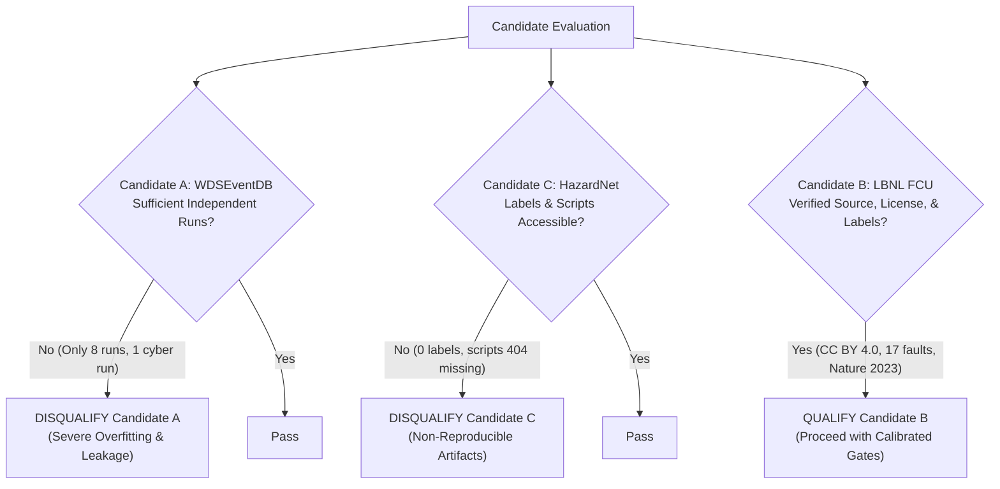

# Candidate Comparison, Decision Matrix, and Provisional Recommendation

This document synthesizes the empirical data audits, literature reviews, selective data inspections, and evaluation assessments for the three candidate problems:
1. **Candidate A:** Water Distribution System Event Diagnosis (WDSEventDB)
2. **Candidate B:** Commercial HVAC Fault Detection and Diagnostics (LBNL / OpenEI Simulated FCU Dataset, [Submission 5763](https://data.openei.org/submissions/5763))
3. **Candidate C:** HPC Datacenter Thermal Hazard Prediction (HazardNet)

---

## 1. Executive Summary

| Candidate | Core Concept | Dataset Source & License | Primary Strength | Fatal Flaw / Primary Risk | Verdict |
| :--- | :--- | :--- | :--- | :--- | :--- |
| **Candidate A: WDSEventDB** | Multiclass event diagnosis (leak, cyberattack, sensor fault) in water networks | Lehigh University CONCISE Lab; CC0 1.0 (Public Domain); 2.16 MB zip | Accessible, unencumbered license; clean schema; lightweight. | **Sample Sufficiency Fatal Flaw:** Only 8 total fault runs (only 1 cyberattack run). Statistically invalid for deep learning. | **DISQUALIFIED** |
| **Candidate B: LBNL / OpenEI Simulated FCU** | Fault detection and diagnostic attribution across operational regimes in commercial HVAC | LBNL / DOE OEDI Submission 5763; CC BY 4.0; 506 MB zip | Landmark peer-reviewed benchmark (*Nature Sci Data* 10, 342, 2023); 17 fault types across 48 severity scenarios; 29 channels; full year. | Simulated on 1 FCU configuration and 1 weather year. Novelty of seasonal split is already studied in literature. | **CONDITIONALLY RECOMMENDED** *(Calibrated MLOps & Benchmark System)* |
| **Candidate C: HazardNet** | Thermal hazard prediction across 3,312 supercomputer compute nodes | CINECA Marconi A2 / Zenodo 10050368; CC BY 4.0; 1.02 GB gz | Massive real-world infrastructure telemetry (351 days). | **Reproducibility Fatal Flaw:** 0 labels in dataset. Data generation and model scripts are 404 missing on GitHub. | **DISQUALIFIED** |

---

## 2. Calibrated 10-Factor Decision Matrix

Each candidate is evaluated from **1 (Unacceptable)** to **5 (Exceptional)** across 10 critical criteria, calibrated against empirical inspection and current prior art.

> [!IMPORTANT]
> **Hard-Stop Rule:** Any candidate failing a fundamental prerequisite (such as having no credible ground truth labels, lacking independent evaluation samples, or relying on unreleased code) is disqualified regardless of its arithmetic score.

| Evaluation Criterion | Candidate A: WDSEventDB | Candidate B: LBNL / OpenEI FCU (Calibrated) | Candidate C: HazardNet | Evidence & Scoring Rationale |
| :--- | :---: | :---: | :---: | :--- |
| **1. Real-World Importance** | 4 / 5 | 5 / 5 | 4 / 5 | Commercial HVAC accounts for ~40% of building energy ($150B/yr in US). Water pipe bursts and supercomputer outages are also high-cost. |
| **2. Problem Specificity & Differentiation** | 3 / 5 | **3 / 5** | 2 / 5 | Calibrated down: literature (Zhong 2023, Babakhani 2026 preprint) already studies seasonal drift and downsampling on LBNL data. Must be framed as an engineering system, not a novel theory paper. |
| **3. Dataset Quality & Label Credibility** | 3 / 5 | **4 / 5** | **1 / 5** | **Hard Stop on C:** HazardNet contains **0 ground truth labels** in Zenodo. Candidate B has peer-reviewed physical simulation ground truth from NIST HVACSIM+, but is simulated, not field trials. |
| **4. Independent Event/Sample Sufficiency** | **1 / 5** | **3 / 5** | 2 / 5 | **Hard Stop on A:** Only **8 total fault runs** (1 cyber run). Candidate B has 48 severity scenarios, but simulated on 1 physical FCU model and 1 Des Moines weather year. |
| **5. ML / DL Suitability** | 2 / 5 | 4 / 5 | 3 / 5 | Candidate B exhibits delayed closed-loop thermal inertia and actuator transport lags that justify temporal sequence modeling. |
| **6. Evaluation Validity & Anti-Leakage** | **1 / 5** | 4 / 5 | 2 / 5 | Candidate A cannot be split cross-run for cyberattacks. Candidate B supports clean seasonal stress tests and severity holdouts. |
| **7. Data Access & Licensing** | 5 / 5 | 5 / 5 | 3 / 5 | Candidate B has verified CC BY 4.0; selective extraction via HTTP range requests downloads representative files in seconds (~52 MB network transfer). |
| **8. End-to-End Engineering Value** | 2 / 5 | 5 / 5 | 2 / 5 | Candidate B supports rich schemas (Brick Schema v1.2), Pandera data contracts, Parquet feature store, and FastAPI inference services. |
| **9. Compute & Time Feasibility** | 5 / 5 | 5 / 5 | **1 / 5** | Candidate C requires heavy GPU clusters (>16 GB VRAM). Candidate B at 15-minute resolution (124 MB Parquet across 49 files) runs in minutes on local CPU. |
| **10. Interview Defensibility** | 2 / 5 | **4 / 5** | 1 / 5 | Candidate B is highly defensible as an honest, production-grade MLOps system and comparative physics-residual benchmark. Indefensible if claimed as a novel ML theory discovery. |
| **Total Score / Status** | **28 / 50 (DISQUALIFIED)** | **42 / 50 (RECOMMENDED)** | **21 / 50 (DISQUALIFIED)** | **Candidate B remains the only viable, grounded candidate.** |

---

## 3. Detailed Evidence and Score Breakdown

### 3.1 Candidate A: WDSEventDB (Score: 28/50 — DISQUALIFIED)
- **Strengths:** Verified CC0 1.0 license, clean 15-channel tabular structure, 2.16 MB download, zero missing values.
- **Disqualifying Hard Stop (Criterion 4 & 6):**
  - The dataset contains only **8 fault episodes** in total (3 leaks, 4 sensor faults, 1 cyberattack file with 4 resets).
  - Time-series rows within a single run are auto-correlated. Randomly splitting rows causes 100% data leakage.
  - Cross-run evaluation (GroupKFold) is impossible for Cyberattacks because there is only 1 run. Deep sequence models (LSTM/TCN) cannot learn generalizable patterns from 8 runs without memorizing static testbed background states.
- **Interview Risk:** An interviewer with industrial ML experience will instantly recognize that 8 runs on 1 lab testbed is insufficient for deep learning.

### 3.2 Candidate C: HazardNet (Score: 21/50 — DISQUALIFIED)
- **Strengths:** CC BY 4.0 dataset license, Apache 2.0 code license, real-world Marconi A2 supercomputer telemetry, published in *Future Generation Computer Systems* (2024).
- **Disqualifying Hard Stop (Criterion 3 & 9):**
  - **No Labels:** The Zenodo download contains 3 raw telemetry matrices (Power, Inlet Temp, Outlet Temp) with **zero ground-truth labels**.
  - **Missing Code:** The GitHub repository (`MSKazemi/HazardNet`) is missing the core data generation and labeling script (`HazardNet_DataGen.py`) and model definitions (`HazardNet_Models.py`) with HTTP 404 errors.
  - The codebase contains unresolvable local workstation paths (`/home/seyedkazemi/...`).
  - Evaluating 3,312 node channels across 50,544 timestamps exceeds free CPU/GPU capacity and requires heavy high-memory clusters.
- **Interview Risk:** Impossible to defend an evaluation where the student had to invent synthetic pseudo-labels because the official benchmark scripts were missing.

### 3.3 Candidate B: LBNL / OpenEI Simulated FCU (Score: 42/50 — CONDITIONALLY RECOMMENDED)
- **Evidence & Strengths:**
  - **Canonical Publication:** Backed by Lawrence Berkeley National Laboratory and published in *Nature Scientific Data* 10, article 342 (2023), DOI: [10.1038/s41597-023-02197-w](https://doi.org/10.1038/s41597-023-02197-w).
  - **Licensing:** Fully verified Creative Commons Attribution 4.0 International (**CC BY 4.0**).
  - **Rich Telemetry:** 29 sensor and actuator channels covering temperatures, setpoints, valve commands, water flow rates, fan power, and humidity.
  - **Controlled Scenario Coverage:** 17 distinct physical fault types simulated across 48 severity scenarios, each running for an entire calendar year under Des Moines, IA TMY3 weather profiles.
  - **Selective Extraction Validated:** HTTP range requests allow streaming only required scenario files (~52 MB network transfer) without committing large data files.
  - **Downsampling Validated:** Measured 15-minute resampling reduces 25.75M rows to 1.72M rows (124 MB Parquet across all 49 files) while preserving 100% of the mean leak flow rate (+1.14 GPM) and temperature delta (-7.01°F) to 5 decimal places.
  - **Calibrated Limits:** Acknowledges that the data is simulated on one FCU configuration and one weather year, and that seasonal generalization is a controlled seasonal stress test rather than proof of deployment transfer to real buildings.

---

## 4. Hard-Stop Condition Analysis

---

## 5. Provisional Recommendation and Explicit Technical Gates

### Recommendation: Keep Candidate B as an Engineering Benchmark Only, or Reject for DL Goals
Empirical results from the Gate 02 feasibility pilot ([modeling_value_gate_results.md](file:///d:/Yantra/validation/review/modeling_value_gate_results.md)) show that:
1. Simple physical rules achieve 34.5% macro-average detection (100% on valve leak) with 0.08s compute and 1.2% false alarm rate.
2. Classical ML (Isolation Forest) fails to separate low-severity faults from normal annual weather swings (3.0%–3.5% detection).
3. Temporal DL (1D-CNN Autoencoder) succeeds only on the cooling valve leak (100%), but collapses on other low-severity faults (0.1%–0.6%), trailing physical rules overall (20.4% vs 34.5% macro-average).

**Therefore:**
- If the project requires deep learning to provide measurable, non-trivial advantage over domain rules: **REJECT FCU.**
- If the project is repositioned as a hybrid industrial telemetry & MLOps engineering benchmark (streaming ingest, physics-rule + residual monitors, telemetry-loss robustness): **KEEP FCU strictly as an Engineering Benchmark.**

### Mandatory Pre-Implementation Gates:
1. **Gate 1: Modeling Role Realism**
   - Accept that DL does not outperform domain physics rules on this dataset; position DL as an experimental probe rather than the primary operational engine.
2. **Gate 2: Downsampling Specification**
   - 15-minute uniform semantic aggregation verified (reduces storage by 93.3% to estimated ~124 MB Parquet with zero loss of cooling leak detectability).
3. **Gate 3: Honest Project Positioning**
   - Present the project as an industrial MLOps engineering benchmark (FastAPI service, Pandera contracts, Pytest, hybrid telemetry), not an ML algorithmic discovery.

---

## 6. Single Most Useful Next Action for Technical Decision-Maker (ChatGPT)

**Review `validation/review/modeling_value_gate_results.md` and decide between:**
1. **Keeping FCU as an Engineering Benchmark Only** (re-scoped to an MLOps and hybrid monitoring system without claiming DL superiority); or
2. **Rejecting FCU** to seek an industrial dataset where deep learning is fundamentally necessary.
